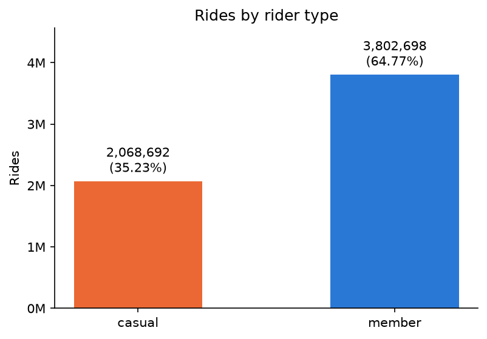
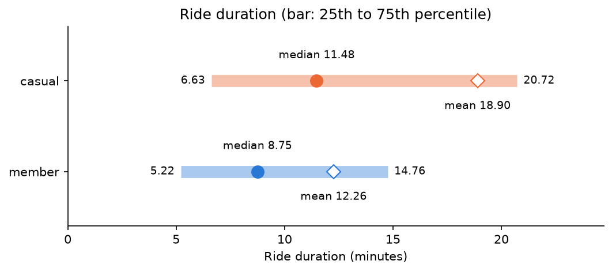
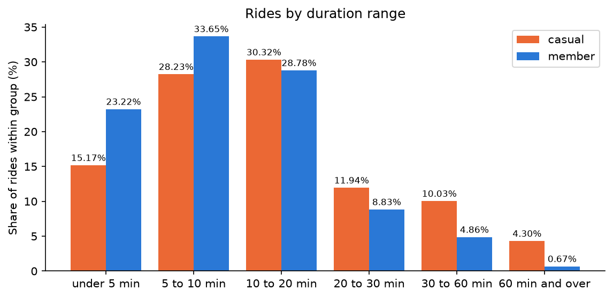
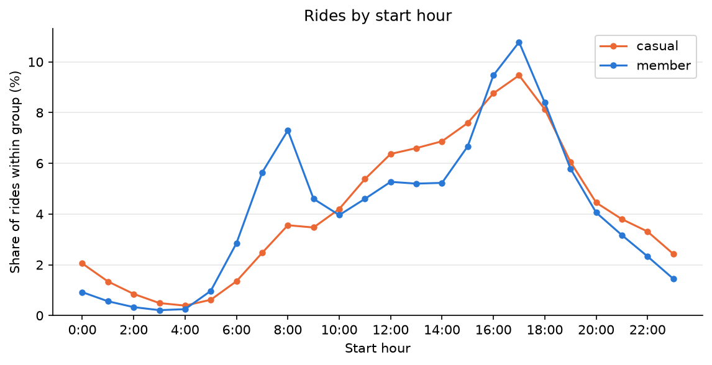
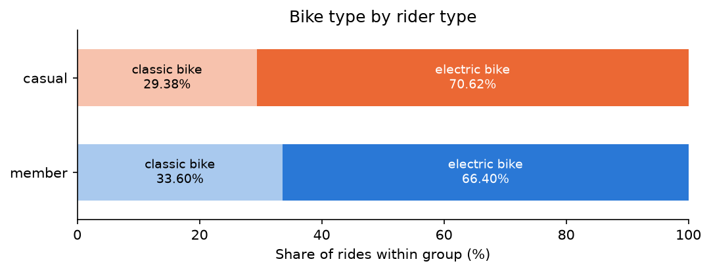
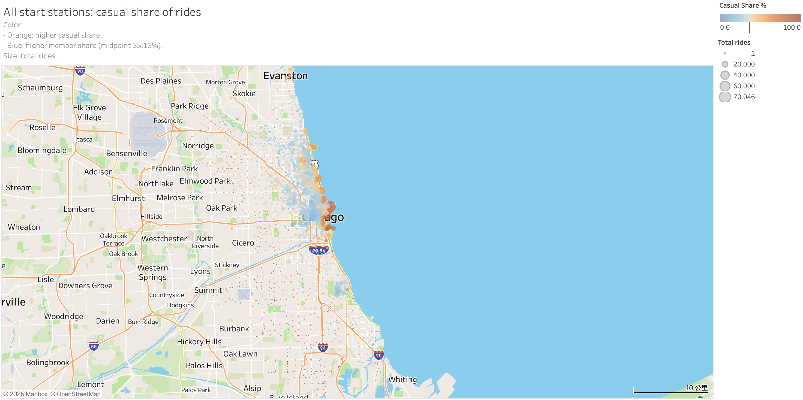
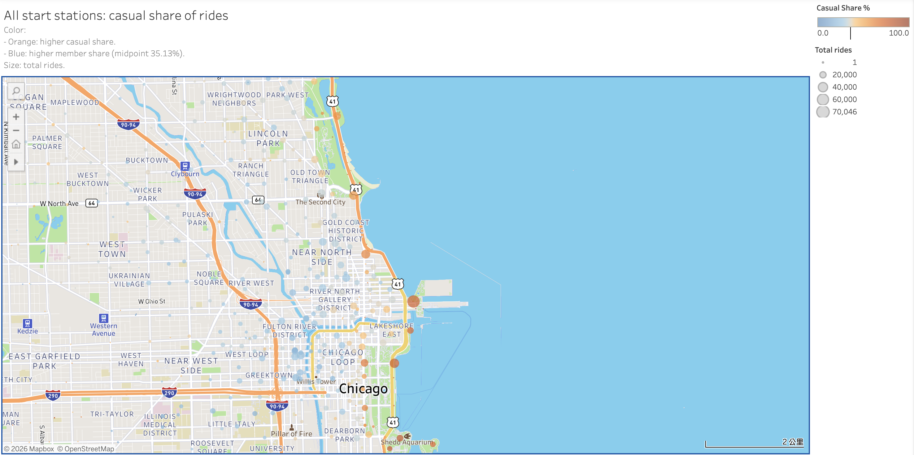
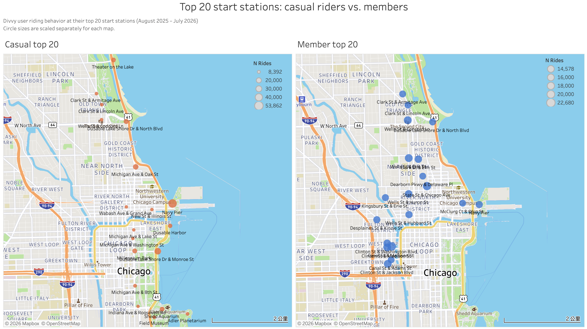

# Cyclistic Bike-Share Analysis: Findings

## 1. Summary

This analysis uses Divvy trip data from August 2025 to July 2026 (5,871,390 cleaned rides) to understand how members and casual riders use the bikes differently and how Cyclistic can convert casual riders into members.

1. **Members take more rides:** Members account for 64.77% of all rides, about 1.84 times the share of casual riders (35.23%).

2. **The two groups have different riding patterns:** Casual riders take longer rides (median 11.48 vs. 8.75 minutes), while members have a higher share of rides during commuting hours (7:00–9:00: 17.54% vs. 9.50%). Casual riders have a higher share of rides from 10:00 to 15:00 (37.01% vs. 30.93%).

3. **Bike type shows little difference:** Electric bikes account for about two-thirds of rides in both groups.

4. **Riding locations differ:** Lakefront stations have many rides and a high share of casual rides, while stations in business districts (the Loop, West Loop, and River North) have a higher share of member rides.

5. **Suggestions for conversion:** We suggest offering membership benefits based on ride duration, reaching casual riders during the middle of the day, and using ads or on-site events at lakefront stations.

**Note:** We do not have rider-level data, so these findings and suggestions are based only on ride records and have not been tested.

## 2. Business question and data

**Business questions:**
1. How do annual members and casual riders use Cyclistic bikes differently?
2. How can Cyclistic convert casual riders into annual members?

**Data:** Divvy trip data from August 2025 to July 2026 (12 monthly files), cleaned as described in [cleaning_log.md](cleaning_log.md).

| Rides used | Rows | Used in |
|---|---|---|
| All cleaned rides | 5,871,390 | Q1 to Q4 |
| Rides with a start station name| 4,690,815 | Q5 |

Note: Q5 ranks start stations, so every ride used in Q5 needs a start station name. A classic bike must be docked at a Divvy station at the end of a ride, so classic bike rides also need an end station name. An electric bike can be locked outside a station, so electric bike rides with no end station name are kept.

The findings below are based on [05_analysis.sql](../sql/05_analysis.sql) and  [analysis.ipynb](../notebooks/analysis.ipynb).

## 3. Findings

### Q1 How many rides does each group take?

**Metric:** Ride count and share by rider type.

**Chart:** 

**Key numbers:** Members account for 64.77% of all rides (3,802,698), while casual riders take 35.23% (2,068,692).

**Finding:** Members take about 1.84 times as many rides as casual riders. 

**Note:** Since we only have trip data and no user info, we cannot tell how many riders are in each group.

### Q2 How long do they ride?

**Metric:** Median ride duration and interquartile range, plus the share of rides in six duration ranges.  
(the median is used because the mean is influenced by outliers)

**Chart:** 

**Key numbers:**
1. Median ride duration: casual riders 11.48 minutes vs. members 8.75 minutes.
2. Interquartile range of ride duration: casual riders 6.63 to 20.72 minutes (14.09) vs. members 5.22 to 14.76 minutes (9.54).
3. Mean ride duration: casual riders 18.90 minutes vs. members 12.26 minutes.
4. Rides under 10 minutes: casual riders 43.40% vs. members 56.87%.
5. Rides of 30 minutes and over: casual riders 14.33% vs. members 5.53%.

**Finding:**
1. Casual riders ride longer than members, with a median duration 2.73 minutes longer than members.
2. The interquartile range of casual riding time is wider than the members', indicating that their ride durations are more spread out.
3. Casual riders show a bigger gap between their mean and median ride duration (7.42 minutes vs. 3.51 for members) because of a higher percentage of long rides lasting 30 minutes or more.
4. Members have a larger share of rides under 10 minutes, while casual riders pull ahead in every bracket starting from 10 to 20 minutes upward.

### Q3 When do they start riding?

**Metric:** The percentage of ride starts for both groups across different time slots of the day (0-23).

**Chart:** 

**Key numbers:**
1. Members have two peak hours at 8:00 (7.30%) and 17:00 (10.78%). Casual riders have one peak hour at 17:00 (9.47%).
2. Rides starting from 7:00 to 9:00: members 17.54% vs. casual riders 9.50%.
3. Rides starting from 10:00 to 15:00: casual riders 37.01% vs. members 30.93%.

**Finding:**
1. 17:00 is the highest peak for both groups. The main differences are in the morning and in the middle of the day.
2. Members have a higher share of rides from 5:00 to 9:00, with a peak at 8:00. Casual riders have no morning peak.
3. Casual riders have a higher share of rides from 10:00 to 15:00 and from 19:00 to 4:00, while members have a higher share from 16:00 to 18:00.

**Interpretation:** It seems that members ride more at typical commuting hours (8:00 and 17:00), while casual riders spread their rides more across the middle of the day and the evening. 

### Q4 Which bike type do they choose?

**Metric:** The proportion of classic and electric bikes used by two groups.

**Chart:** 

**Key numbers:** Electric bike rides: casual riders 70.62% vs. members 66.40%.

**Finding:** Electric bikes are the majority for both groups, at about two thirds of rides. Casual riders have a slightly higher share of electric bike rides than members, a difference of 4.22 percentage points.

### Q5 What is the difference in starting stations between casual riders and members?

**Purpose:** Identify where casual riders are most concentrated compared with members, and use these spatial patterns to identify potential locations for marketing to casual riders.

**Metric:** Casual riders' share of rides and the total rides at each of the 1,955 start stations.

**Interactive maps:** [All start stations](https://public.tableau.com/app/profile/kevin.lin4959/viz/Allstartstationscasualshareofrides/1) and [Top 20 start stations](https://public.tableau.com/app/profile/kevin.lin4959/viz/Cyclist-case-study_17905846497750/1_1) on Tableau Public

#### 5.1 Where do the two groups start their rides?

**Chart:** 

*Color: casual riders' share of rides at each station, with the midpoint at their overall share (35.13%). Orange means a higher casual share, and blue means a higher member share. Size: total rides at each station.*

**Observations:**
1. The stations with the most rides are along the lakefront and in the city center. Stations outside these areas are much smaller, except for a group of stations in Hyde Park around the University of Chicago.
2. Most stations along the lakefront are orange, indicating a higher-than-average casual share; however, stations farther inland gradually become blue, indicating a higher member share.
3. The largest orange stations are concentrated around major lakefront attractions, including Museum Campus, Grant Park, DuSable Harbor, Navy Pier, Oak Street Beach, and North Avenue Beach.
4. The stations in the business districts (the Loop, West Loop, and River North) are mostly blue, indicating a higher share of member rides.
5. The stations in residential neighborhoods (e.g., Lincoln Park, Wicker Park, Logan Square) tend to be smaller and mostly light blue, suggesting that their casual share is closer to the overall casual share (35.13%).
6. Many smaller stations on the South and West Sides are orange, but most have fewer than 1,000 rides, suggesting that their high casual share does not necessarily correspond to a large number of casual rides.

**Interpretation:** The map suggests that stations with both high ride volumes and high casual shares are concentrated along the lakefront, while members have a higher share in the major business districts. This suggests that the lakefront may be a suitable area for targeting casual riders through place-based marketing.

#### 5.2 A closer look at the top 20 stations

**Why a closer look:** The map in Section 5.1 reveals a general spatial pattern, but the large number of stations makes it difficult to identify and compare which specific stations have the most rides. Therefore, we focus on the top 20 start stations for each group to examine which high-volume stations drive the observed pattern.

**Why 20 stations:** We selected 20 stations per group since this provides us with better readability when observing highest-volume stations. These top 20 stations account for only 18.53% of casual rides and 11.28% of member rides, so the findings in Section 5.2 should be interpreted as observations about this selected subset, rather than as representative of the entire system.

**Ranking:** Stations are ranked by each group's own total ride count rather than by casual share. This allows us to identify the stations that contribute the most rides within each group. Among casual riders' top 20 stations, 19 have a casual share above the overall casual share (35.13%); the only exception is Wells St & Concord Ln (32.81%).

*Zoomed to the area where most top stations are. Not shown: Montrose Harbor (casual rank 10, north) and University Ave & 57th St (member rank 12, Hyde Park, south).*

**Observations**:
1. Most of the casual riders' top stations are between Field Museum in the south and Theater on the Lake in the north, with one more station (Montrose Harbor) further north.
2. 10 of the casual riders' top 20 stations are on the lakefront (Navy Pier, DuSable Lake Shore Dr & Monroe St, DuSable Lake Shore Dr & North Blvd, Theater on the Lake, Dusable Harbor, Shedd Aquarium, Adler Planetarium, Field Museum, Montrose Harbor, and Michigan Ave & Oak St), and 4 are around the west side of Grant Park (Millennium Park, Indiana Ave & Roosevelt Rd, Michigan Ave & Washington St, and Michigan Ave & 8th St).
3. Most of the members' top stations are between Clinton St & Jackson Blvd in the south and Clark St & Armitage Ave in the north, with one more station (University Ave & 57th St) further south in Hyde Park.
4. Compared with casual riders, members' top stations are further from the lakefront and more concentrated in the city center (West Loop, River North, and the Near North Side).
5. Five stations are in the top 20 of both groups: Navy Pier, DuSable Lake Shore Dr & North Blvd, Wells St & Concord Ln, Clark St & Armitage Ave, and Clark St & Lincoln Ave. Except for Navy Pier, all of them are in Lincoln Park and Old Town.

**Summary:** The top-station analysis reinforces the spatial pattern identified in Section 5.1. Casual riders' highest-volume start stations are concentrated along the lakefront and around Grant Park, while members' top stations are more concentrated in the city center, particularly the West Loop, River North, and Near North Side. This closer look shows that the overall pattern is also visible among the highest-volume stations in each group.

## 4. Suggestions for converting casual riders

Casual riders account for 35.23% of all rides (2,068,692). Based on the differences identified in Q1 to Q5, we suggest three directions for converting casual riders into members. 

Note: These suggestions are based only on ride records and have not been tested.

1. **What to offer:** Casual riders take longer rides than members (median 11.48 vs. 8.75 minutes), and 14.33% of their rides last 30 minutes or more (vs. 5.53% for members). A membership offer based on ride duration, such as lower rates for longer rides, could better match how casual riders use the bikes.

2. **When to reach them:** Unlike members, casual riders do not have a clear morning peak. Campaigns during the middle of the day can be more suitable for casual riders, since a higher share of their rides start from 10:00 to 15:00 than members' rides (37.01% vs. 30.93%). Additionally, both groups have their peak at 17:00 (the commuting hour). We can therefore propose campaigns targeting casual riders who commute during this period.

3. **Where to reach them:** Stations with a high number of rides and a high share of casual riders are mainly located along the lakefront, around Museum Campus, Grant Park, DuSable Harbor, Navy Pier, Oak Street Beach, and North Avenue Beach. The top 20 stations for casual riders, which account for 18.53% of their rides, are also mostly located along the lakefront and around Grant Park. Therefore, ads or on-site events at these stations could reach more casual riders than stations in business districts.

Bike type is probably not a useful selling point, since electric bikes make up about two thirds of rides in both groups (casual riders 70.62% vs. members 66.40%).

**Limits of these suggestions:**
1. We do not have price or membership benefit data, so we cannot estimate how much a casual rider would save as a member, or check whether the offer in point 1 overlaps with current benefits.
2. We do not have rider IDs, so we cannot distinguish tourists from local residents. Casual riders along the lakefront may include many tourists, who may be less likely to purchase an annual membership.
3. We did not analyze the day of the week, so the 17:00 peak may include weekend leisure rides as well as weekday commuting.

## 5. Limitations

1. Since we only have trip data and no user info, we cannot tell how many riders are in each group.
2. Since we did not analyze which day of the week the rides took place, our peak hour analysis does not break down into weekdays and weekends.
3. Q5 uses 4,690,815 rides. Rides with no start station name are excluded, and all of them are electric bike rides, so 30.70% of electric bike rides are left out of Q5.
4. Station names and IDs do not map one-to-one in the source data. The check in 05_analysis.sql (5-4) found no effect on the ranking of the top 20 stations.
5. The insights in Section 5.1 are based on a visual assessment of the map. Because stations were not formally categorized into regional zones, we do not have exact ride counts for specific areas like the lakefront or downtown business districts.

## Appendix: files and sources

| File | Purpose |
|---|---|
| [01_import.sql](../sql/01_import.sql) | Combine the 12 monthly files |
| [02_profile.sql](../sql/02_profile.sql) | Profile data quality |
| [03_investigate.sql](../sql/03_investigate.sql) | Investigate the issues found |
| [04_clean.sql](../sql/04_clean.sql) | Build the cleaned table |
| [05_analysis.sql](../sql/05_analysis.sql) | Build one summary table per question |
| [cleaning_log.md](cleaning_log.md) | Cleaning decisions |
| [analysis.ipynb](../notebooks/analysis.ipynb) | Charts for Q1 to Q4 |

**Data source:** Divvy trip data, https://divvy-tripdata.s3.amazonaws.com/index.html, made available by Motivate International Inc. under the Divvy Data License Agreement.

**Maps (Q5):** Tableau Public, [All start stations](https://public.tableau.com/app/profile/kevin.lin4959/viz/Allstartstationscasualshareofrides/1) and [Top 20 start stations](https://public.tableau.com/app/profile/kevin.lin4959/viz/Cyclist-case-study_17905846497750/1_1). Base map © Mapbox © OpenStreetMap.